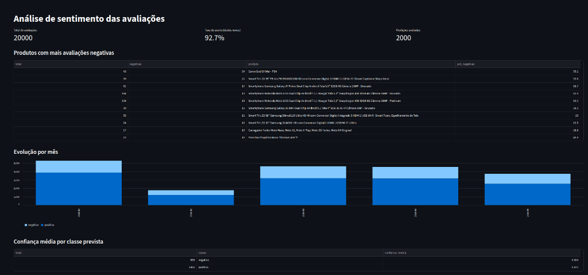

# Classificador de Avaliações com MongoDB

<p align="center">
  <a href="README.md">English</a> | <b>Português</b>
</p>

<p align="center">
  
  
  
  
  
  
</p>

Projeto de IA em Python que classifica avaliações de produtos em português como **positivas** ou **negativas**, utilizando o **MongoDB** como armazenamento analítico central para textos brutos, metadados e predições em lote.

---

## Dashboard Interativo (Streamlit)

O projeto conta com uma interface gráfica construída em Streamlit para visualização dos KPIs analíticos, ranking de produtos com maior insatisfação e série temporal:

<!-- ESPAÇO PARA O PRINT DO DASHBOARD: Salve o print da tela em docs/images/dashboard.png -->
<p align="center">
  
</p>

---

## Como funciona

1. **Ingestão:** As avaliações de e-commerce são carregadas no MongoDB como documentos semiestruturados.
2. **Treinamento:** Documentos previamente rotulados são utilizados para treinar um pipeline de NLP (TF-IDF + Regressão Logística).
3. **Classificação em Lote:** O modelo infere o sentimento dos documentos sem rótulo (dados simulando produção).
4. **Gravação Retroativa:** A predição (classe, confiança, versão e data) é gravada de volta no próprio documento via `UpdateOne`.
5. **Agregações Analíticas:** Pipelines de agregação do MongoDB consolidam métricas de negócio (ex.: ranking de insatisfação por produto e evolução mensal de sentimento).

---

## Stack Tecnológica

| Parte | Ferramenta | Finalidade |
|---|---|---|
| **Linguagem** | Python 3.11+ | Desenvolvimento de serviços e scripts |
| **Banco de Dados** | MongoDB 8.2 (Docker) | Armazenamento flexível e aggregation pipelines |
| **Acesso ao Banco** | PyMongo | Driver oficial de conexão e operações em lote |
| **Manipulação de Dados** | Pandas | Higienização, amostragem e reshaping (`pivot`) |
| **Machine Learning** | Scikit-Learn & Joblib | Pipeline TF-IDF, Regressão Logística e serialização |
| **Testes Automatizados** | Pytest | Testes unitários de rotulagem, ingestão e ML |
| **Interface / BI** | Streamlit | Dashboard analítico web reativo |

---

## Arquitetura do Sistema

Arquitetura em camadas com baixo acoplamento (*Repository Pattern*), onde cada componente comunica-se apenas com sua camada adjacente:

```
┌─────────────────────────────────────────┐
│     Interface (Terminal / Dashboard)    │
├─────────────────────────────────────────┤
│  Serviços: ingestão, treino, predição,  │
│               analytics                 │
├─────────────────────────────────────────┤
│  Repositório (ponto único de PyMongo)   │
├─────────────────────────────────────────┤
│           MongoDB (Docker)              │
└─────────────────────────────────────────┘
```

>Para detalhes sobre padrões adotados (*Service Layer*, *DTOs*, *Dependency Injection*), fluxos de dados e otimizações de índices BSON, consulte o documento dedicado: **[docs/ARCHITECTURE.md](docs/ARCHITECTURE.md)**.

---

## Estrutura do Projeto

```
classificador-avaliacoes/
├─ docker-compose.yml         # Definição do serviço MongoDB 8.2
├─ run_pipeline.py            # Orquestrador automatizado da esteira de ML
├─ requirements.txt           # Dependências do projeto
├─ pytest.ini                 # Configuração de paths do Pytest
├─ LICENSE                    # Licença MIT
├─ AGENTS.md                  # Guia e diretrizes para agentes de IA
├─ .env.example               # Modelo de variáveis de ambiente
├─ docs/
│  ├─ adr/                    # Registros de Decisões de Arquitetura (ADRs)
│  ├─ ARCHITECTURE.md         # Especificação arquitetural detalhada
│  ├─ ROADMAP_V2.md           # Planejamento completo da Versão 2
│  └─ images/                 # Imagens e capturas de tela da documentação
├─ data/
│  ├─ raw/B2W-Reviews01.csv   # Dataset original bruto (não versionado)
│  └─ reviews.csv             # Amostra higienizada e rotulada (não versionado)
├─ models/                    # Artefato do modelo serializado (.joblib)
├─ src/
│  ├─ config.py               # Centralização de variáveis de ambiente
│  ├─ prepare_data.py         # Etapa 1: Limpeza, regras de negócio e rotulagem
│  ├─ repository.py           # Etapa 2: Repositório com Aggregation Pipelines
│  ├─ ingest.py               # Etapa 3: Ingestão BSON do CSV para o MongoDB
│  ├─ train.py                # Etapa 4: Treinamento e avaliação do modelo
│  ├─ predict.py              # Etapa 5: Predição em lote e auditoria
│  ├─ analytics.py            # Etapa 6: Relatórios tabulares via terminal
│  └─ dashboard.py            # Etapa 6: Aplicação web Streamlit
└─ tests/                     # Testes unitários automatizados (isolados do banco)
   ├─ test_rotulagem.py
   ├─ test_ingest.py
   └─ test_modelo.py
```

---

## Dataset

Utiliza o [B2W-Reviews01](https://github.com/b2wdigital/b2w-reviews01), um corpus aberto de mais de 130 mil avaliações de e-commerce no mercado brasileiro com notas de 1 a 5.

* **Colunas selecionadas:** `review_text`, `overall_rating`, `product_name`, `submission_date`.
* **Download:** Baixe o arquivo `B2W-Reviews01.csv` do repositório oficial e salve em `data/raw/B2W-Reviews01.csv`.
* *Nota:* O carregamento direto via CSV local é o método recomendado para evitar inconsistências de scripts em versões recentes da biblioteca `datasets`.

### Regras de Negócio e Higienização

| Regra | Ação | Justificativa |
|---|---|---|
| **Nota 4 ou 5** | Rótulo `positivo` | Satisfação evidente do consumidor |
| **Nota 1 ou 2** | Rótulo `negativo` | Reclamação ou problema no pedido |
| **Nota 3** | Descartada | Opiniões neutras ou ambíguas |
| **Textos < 10 chars ou Nulos** | Descartados | Ausência de valor semântico para NLP |
| **Textos Duplicados** | Removidos | Prevenção de viés por spam ou repetição |
| **Amostragem Reprodutível** | 20.000 linhas (`seed=42`) | Treino ágil e balanceamento controlado |

---

## Esquema do Documento no MongoDB

```json
{
  "_id": {"$oid": "653b1e7c8f9b2a1234567890"},
  "texto": "Chegou rápido, mas a embalagem veio amassada",
  "produto": "Fone Bluetooth X",
  "data": "2018-03-12T14:05:00.000Z",
  "nota": 2,
  "rotulo": null,
  "rotulo_real": "negativo",
  "predicao": {
    "classe": "negativo",
    "confianca": 0.71,
    "modelo": "modelo_v1",
    "data": "2026-10-24T14:05:00.000Z"
  }
}
```

* **Simulação de Produção:** Cerca de 10% dos documentos são ingeridos com `rotulo: null`.
* **Auditoria:** O campo `rotulo_real` armazena o gabarito original, nunca sendo exposto durante o treino.
* **Índices Otimizados:** Criação automática de índices nos campos `rotulo` e `produto` para acelerar agregação e busca.

---

## Como Executar

### Pré-requisitos
* Python 3.11 ou superior
* Docker e Docker Compose

> [!NOTE]
> **Compatibilidade de Kernel Linux:** Versões de kernel 6.19+ possuem incompatibilidade com a imagem `mongo:8.0` (SERVER-121912). Este projeto adota explicitamente a imagem estável **`mongo:8.2`**.

### 1. Clonar e Preparar o Ambiente

```bash
git clone https://github.com/Nickzs8/Classificador-avaliacoes.git
cd classificador-avaliacoes

python -m venv .venv
source .venv/bin/activate        # No Windows: .venv\Scripts\activate
pip install -r requirements.txt
```

### 2. Configurar Variáveis de Ambiente

Copie o arquivo de exemplo:
```bash
cp .env.example .env
```

Configuração padrão sugerida:
```env
MONGO_USER=admin
MONGO_PASSWORD=troque_esta_senha
MONGO_HOST=localhost
MONGO_PORT=27017
MONGO_DB=reviews_db
MONGO_COLLECTION=reviews
MODEL_PATH=models/modelo_v1.joblib
```
*(Evite caracteres como `$` na senha devido à interpretação de variáveis do Docker Compose).*

### 3. Pipeline de Execução

#### 1) Iniciar Banco e Treinar o Modelo
Inicie o contêiner do MongoDB e execute a esteira automatizada (preparação dos dados, ingestão no banco e treinamento do modelo):

```bash
docker compose up -d
python run_pipeline.py
```

#### 2) Inferência em Lote e Visualização
Com o modelo treinado, execute a inferência nas avaliações pendentes e visualize os relatórios analíticos:

```bash
python src/predict.py                # Classifica documentos pendentes no MongoDB
python src/analytics.py              # Relatório consolidado no terminal
streamlit run src/dashboard.py       # Dashboard visual no navegador
```

---

## Testes Automatizados

O projeto conta com suíte de testes unitários cobrindo regras de higienização, integridade de esquema e pipeline de aprendizado de máquina. **Os testes não dependem de conexão com o banco de dados.**

```bash
pytest -v
```

---

## Métricas de Desempenho

Como os dados possuem distribuição assimétrica (maior incidência de positivos), a avaliação prioriza o **F1-Score por classe** com `class_weight="balanced"`:

| Classe | Precisão | Recall | F1-Score |
|---|---|---|---|
| **Positivo** | 0.98 | 0.93 | 0.95 |
| **Negativo** | 0.84 | 0.94 | 0.89 |

* **Comportamento do Modelo:** O recall elevado na classe negativa (0.94) assegura que a quase totalidade das insatisfações de clientes seja capturada pela esteira analítica.
* **Generalização em Dados Não Vistos:** Acurácia de **92.7%** aferida nos 2.000 documentos não rotulados confrontados contra o `rotulo_real` (com confiança média de **92.4%** para negativos e **97.7%** para positivos).

---

## Roadmap da V2: Inferência em Tempo Real com API REST

Na **V2**, o projeto evolui da classificação em lote para permitir que o usuário envie avaliações externas em tempo real via **FastAPI** e receba a predição instantaneamente:

```
Usuário → Interface → API (FastAPI) → Serviço de classificação → modelo (.joblib)
                          │
                          └→ ReviewRepository → MongoDB (salva a avaliação já classificada)
```

### Principais Decisões de Arquitetura (ADR)
* **FastAPI + Uvicorn:** Validação automática com Pydantic e documentação OpenAPI em `/docs`.
* **Rotas síncronas (`def`):** Proteção do event loop delegando chamadas bloqueantes do `pymongo` e `scikit-learn` ao pool de threads.
* **Service Layer (`classificador.py`):** Lógica de predição compartilhada entre batch e API sem duplicação de código.
* **Injeção de Dependências (`Depends`):** Desacoplamento para testes com mocks em memória sem necessidade do MongoDB ativo.

Consulte o planejamento detalhado, schemas e contrato dos endpoints em: **[docs/ROADMAP_V2.md](docs/ROADMAP_V2.md)**.
Explore todas as decisões arquiteturais e trade-offs em: **[docs/adr/](docs/adr/)**.

---

## Licença

Distribuído sob a licença MIT. Consulte o arquivo [LICENSE](LICENSE) para mais detalhes.
O dataset [B2W-Reviews01](https://github.com/b2wdigital/b2w-reviews01) segue a sua respectiva licença original.
