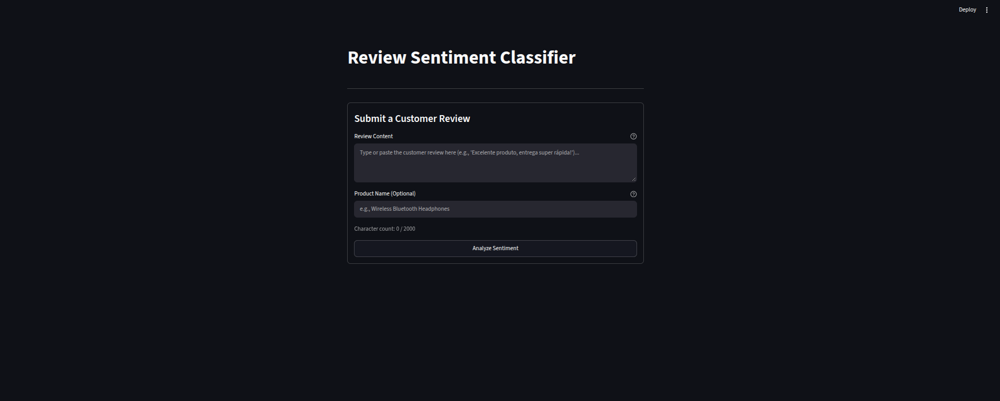

# Classificador de Avaliações com MongoDB & FastAPI

<p align="center">
  <a href="README.md">English</a> | <b>Português</b>
</p>

<p align="center">
  
  
  
  
  
  
  
</p>

Sistema de Machine Learning pronto para produção que classifica avaliações de produtos como **positivas** ou **negativas**, contando com:
* **Esteira Analítica em Lote:** Higieniza, rotula e ingere mais de 20.000 documentos no **MongoDB 8.2**, com treinamento automatizado de modelo Scikit-Learn e pipelines de agregação analítica.
* **API REST em Tempo Real:** Desenvolvida com **FastAPI**, rotas síncronas em threadpool (*non-blocking event loop*), validação rigorosa de contratos com Pydantic V2 e documentação OpenAPI interativa.
* **Apresentação Web Interativa:** Construída em **Streamlit** com inferência de sentimento em tempo real para o cliente e dashboard analítico de BI.
* **Ergonomia para Desenvolvedores:** Gerenciamento unificado via **GNU Makefile** (`make dev`, `make api`, `make ui`, `make test`).

---

## Interfaces Web (Streamlit)

O projeto conta com duas camadas de apresentação visual web:

### 1. Classificação de Sentimento em Tempo Real (`src/interface/app.py`)
Permite que o usuário submeta avaliações avulsas e receba a predição de sentimento, a barra de confiança calibrada e a persistência no MongoDB em tempo real:

<p align="center">
  
</p>

### 2. Dashboard Analítico de BI (`src/interface/dashboard.py`)
Monitora KPIs analíticos, ranking de produtos com maior insatisfação, série temporal de evolução mensal e histórico das avaliações recentes:

<p align="center">
  
</p>

---

## Stack Tecnológica

| Camada | Ferramenta | Finalidade |
|---|---|---|
| **Linguagem** | Python 3.11+ | Serviços centrais, pipelines de dados e APIs |
| **API REST** | FastAPI & Uvicorn | API REST ASGI de alta performance com documentação OpenAPI interativa |
| **Contratos de Dados** | Pydantic V2 | Sanitização de entrada, validação de tipos e serialização de DTOs |
| **Banco de Dados** | MongoDB 8.2 (Docker) | Armazenamento de documentos flexíveis e pipelines analíticos |
| **Driver de Banco** | PyMongo | Driver nativo e operações em lote via Repository Pattern |
| **Machine Learning** | Scikit-Learn & Joblib | Pipeline TF-IDF, Regressão Logística e serialização de modelos |
| **Processamento de Dados** | Pandas | Limpeza, amostragem e reformatação tabular (`pivot`) |
| **Cliente HTTP** | HTTPX | Cliente síncrono resiliente integrando Streamlit ao FastAPI |
| **Apresentação Web** | Streamlit | Testador de sentimento em tempo real e dashboard analítico |
| **Testes Automatizados** | Pytest | 39 testes com mocks em memória (`TestClient`, zero dependência de banco) |
| **Automação** | GNU Make & Docker | Orquestração de comandos em 1 linha (`Makefile`, `docker-compose.yml`) |

---

## Arquitetura do Sistema

Arquitetura em camadas desacopladas aplicando **Repository Pattern**, **Service Layer** e **Injeção de Dependências**, garantindo isolamento total entre controladores HTTP, modelo de ML e persistência:

```
┌────────────────────────────────────────────────────────┐
│             Camada de Apresentação (Streamlit)         │
│   src/interface/app.py    │   src/interface/dashboard.py │
└───────────────────────┬──────────────────────┬─────────┘
                        │ (HTTP / httpx)       │ (Interno)
┌───────────────────────▼────────────────┐     │
│         Camada de API REST (FastAPI)   │     │
│   POST /reviews     │  GET /reviews    │     │
└───────────────────────┬────────────────┘     │
                        ▼                      │
┌────────────────────────────────────────┐     │
│       Service Layer (Classifier)       │     │
│      Lógica Compartilhada de ML        │     │
└───────────────────────┬────────────────┘     │
                        ▼                      ▼
┌────────────────────────────────────────────────────────┐
│     Repository Layer (src/repository.py - PyMongo)     │
└───────────────────────────────┬────────────────────────┘
                                ▼
┌────────────────────────────────────────────────────────┐
│               MongoDB 8.2 (Contêiner Docker)           │
└────────────────────────────────────────────────────────┘
```

> Para diagramas detalhados, fluxos de dados e padrões de projeto, consulte **[docs/ARCHITECTURE.md](docs/ARCHITECTURE.md)** e os **[docs/adr/](docs/adr/)**.

---

## Estrutura do Projeto

```text
review-classifier/
├── data/              # Datasets brutos e amostras processadas (ignorado no git)
├── docs/              # Registros de Decisões de Arquitetura (ADRs) e Roadmap do projeto
├── models/            # Modelos de Machine Learning serializados (.joblib, ignorado)
├── src/               # Código-fonte da aplicação
│   ├── api/           # Camada de API REST (endpoints FastAPI, schemas Pydantic e dependências)
│   ├── interface/     # Camada de apresentação web (UI Streamlit de classificação e dashboard de BI)
│   └── services/      # Camada de serviços e lógica compartilhada de inferência de ML
└── tests/             # Suíte de testes unitários e de integração automatizados (Pytest)
```

---

## Como Iniciar o Projeto do Zero

Siga este passo a passo estruturado para clonar, configurar o ambiente, subir o banco de dados, treinar o modelo e iniciar as aplicações do zero:

### 1. Pré-requisitos
Certifique-se de ter instalado em sua máquina:
* **Python 3.11+** (`python3 --version`)
* **Docker & Docker Compose** (`docker compose version`)
* **Git** (`git --version`)
* *(Opcional, recomendado)* **GNU Make** (`make --version`)

### 2. Clonar o Repositório
```bash
git clone https://github.com/Nickzs8/review-classifier.git
cd review-classifier
```

### 3. Criar e Ativar o Ambiente Virtual (`.venv`)
```bash
# Cria o ambiente virtual
python3 -m venv .venv

# Ativa o ambiente no Linux / macOS:
source .venv/bin/activate

# (Alternativa no Windows PowerShell: .venv\Scripts\Activate.ps1)
```

### 4. Instalar as Dependências
```bash
pip install --upgrade pip
pip install -r requirements.txt
```

### 5. Configurar as Variáveis de Ambiente
Copie o arquivo de exemplo para gerar o `.env` local:
```bash
cp .env.example .env
```
*(A configuração padrão já aponta para `localhost:27017` com banco `reviews_db` e coleção `reviews`).*

### 6. Iniciar a Infraestrutura do MongoDB
Suba o contêiner do MongoDB 8.2 em segundo plano:
```bash
make up
# ou diretamente via Docker Compose:
docker compose up -d
```
Verifique se o contêiner está ativo e saudável:
```bash
docker compose ps
```

### 7. Executar a Esteira Completa de Dados & Machine Learning
Execute a pipeline de 4 etapas que prepara os dados, ingere no MongoDB, treina o modelo NLP e classifica as avaliações pendentes:
```bash
make pipeline
# ou diretamente via Python:
python run_pipeline.py
```
> **O que esta etapa executa:**
> 1. `src/prepare_data.py`: Higieniza o CSV bruto e extrai amostra balanceada de 20.000 avaliações.
> 2. `src/ingest.py`: Serializa documentos BSON no MongoDB e cria índices otimizados.
> 3. `src/train.py`: Treina o classificador TF-IDF + Regressão Logística (~93% de acurácia) e exporta `models/modelo_v1.joblib`.
> 4. `src/predict.py`: Realiza predição em lote nas 2.000 avaliações sem rótulo e audita a acurácia (92.7%).

### 8. Rodar a Suíte de Testes Automatizados
Valide a integridade do código e a garantia de isolamento total de banco com:
```bash
make test
# ou:
pytest -v
```

### 9. Iniciar as Aplicações
Escolha como prefere rodar os serviços:

* **Opção A: Rodar a Stack Completa (API + Interface Web em paralelo)**
  ```bash
  make dev
  ```
  * Backend API: [http://localhost:8000](http://localhost:8000) (Swagger: [/docs](http://localhost:8000/docs))
  * Interface Web do Cliente: [http://localhost:8501](http://localhost:8501)

* **Opção B: Rodar os Serviços Individualmente**
  * **Servidor FastAPI:** `make api` (ou `uvicorn api.main:app --reload --app-dir src`)
  * **Interface Web de Avaliações:** `make ui` (ou `streamlit run src/interface/app.py`)
  * **Dashboard Analítico de BI:** `make dashboard` (ou `streamlit run src/interface/dashboard.py`)

---

## Referência de Comandos do Makefile

Para o fluxo diário de desenvolvimento, o **GNU Makefile** oferece atalhos convenientes de 1 linha:

| Comando | Ação |
|---|---|
| **`make dev`** | **Inicia a API FastAPI e a Interface Streamlit juntas em paralelo** |
| **`make api`** | Inicia o servidor backend FastAPI com auto-reload (`http://localhost:8000`) |
| **`make ui`** | Inicia a interface de classificação do cliente (`http://localhost:8501`) |
| **`make dashboard`** | Inicia o dashboard analítico de métricas |
| **`make test`** | Executa a suíte de 39 testes automatizados (~1.5s) |
| **`make up`** | Sobe o contêiner do MongoDB em segundo plano |
| **`make down`** | Para os contêineres do MongoDB |
| **`make pipeline`** | Executa a esteira de dados (preparar -> ingerir -> treinar -> predizer) |
| **`make help`** | Exibe a lista completa de comandos |

> [!NOTE]
> **Compatibilidade com Windows:** O utilitário `make` é nativo de ambientes Linux e macOS. Em ambientes Windows puros (PowerShell / Prompt de Comando), o comando `make` não vem instalado por padrão. Usuários de Windows podem:
> 1. Utilizar o **WSL (Windows Subsystem for Linux)** ou o terminal do **Git Bash**.
> 2. Instalar o GNU Make via gerenciador de pacotes como **Chocolatey** (`choco install make`) ou **Winget**.
> 3. Ou executar os comandos originais do Python/Docker demonstrados no passo a passo acima.

---

## Documentação da API REST (FastAPI)

Com a API em execução (`make api` ou `make dev`), acesse a documentação OpenAPI interativa:
* **Swagger UI Interativo:** [http://localhost:8000/docs](http://localhost:8000/docs)
* **Documentação ReDoc:** [http://localhost:8000/redoc](http://localhost:8000/redoc)

### Visão Geral dos Endpoints

| Método | Endpoint | Descrição | Status Code |
|---|---|---|---|
| `POST` | `/reviews` | Submete avaliação, infere sentimento em tempo real e salva no MongoDB | `201 Created` |
| `GET` | `/reviews/{id}` | Busca avaliação por ObjectId hexadecimal do MongoDB | `200 OK` / `404 Not Found` |
| `GET` | `/reviews?limit=10` | Lista as avaliações mais recentes em ordem decrescente de data | `200 OK` |
| `GET` | `/health` | Healthcheck validando API, conectividade com MongoDB e modelo de ML | `200 OK` / `503 Unavailable` |

### Exemplos Práticos de Consumo com `curl`

#### 1. Submeter uma Avaliação (`POST /reviews`)

```bash
curl -X POST "http://localhost:8000/reviews" \
  -H "Content-Type: application/json" \
  -d '{
    "text": "Entrega super rápida e o fone tem um som excelente! Recomendo muito.",
    "product": "Fone Bluetooth Pro"
  }'
```

**Resposta (`201 Created`):**
```json
{
  "id": "6720d2a1e4b0a1d2c3e4f5b2",
  "text": "Entrega super rápida e o fone tem um som excelente! Recomendo muito.",
  "product": "Fone Bluetooth Pro",
  "sentiment": "positive",
  "confidence": 0.965,
  "model": "modelo_v1",
  "date": "2026-10-27T20:30:00Z"
}
```

* Validação: O texto deve ter entre 3 e 2000 caracteres (retorna `422 Unprocessable Entity` se fora do intervalo).
* Gravado com `origin: "api"`, `rating: null` e `true_label: null` (garantindo que entradas da API nunca contaminem o retreino do modelo nem distorçam as métricas de acurácia global).

#### 2. Buscar Avaliação por ID (`GET /reviews/{id}`)

```bash
curl -X GET "http://localhost:8000/reviews/6720d2a1e4b0a1d2c3e4f5b2"
```

#### 3. Listar Avaliações Recentes (`GET /reviews?limit=5`)

```bash
curl -X GET "http://localhost:8000/reviews?limit=5"
```

#### 4. Checagem de Saúde do Sistema (`GET /health`)

```bash
curl -X GET "http://localhost:8000/health"
```

**Resposta (`200 OK`):**
```json
{
  "status": "ok",
  "database": true,
  "model": true
}
```

---

## Testes Automatizados

A suíte de testes garante isolamento completo: **nenhum teste depende do MongoDB estar rodando**. O repositório e o classificador são substituídos em memória por mocks (`FakeReviewRepository` e `FakeClassifier`) via injeção de dependência (`app.dependency_overrides`).

```bash
make test
# ou:
pytest -v
```

Resultado:
```text
============================== 39 passed in 1.45s ==============================
```

---

## Registros de Decisões de Arquitetura (ADRs)

Todas as decisões arquiteturais fundamentais, escolhas tecnológicas e compensações (*trade-offs*) do projeto estão documentadas no padrão MADR (*Markdown Any Decision Records*).

Para consultar a tabela consolidada com o sumário de todas as decisões, status e escopos, consulte o **[Índice de Registros de Decisões de Arquitetura](docs/adr/README.md)**.

---

## Licença

Distribuído sob a licença MIT. Consulte o arquivo [LICENSE](LICENSE) para mais detalhes.
O dataset [B2W-Reviews01](https://github.com/b2wdigital/b2w-reviews01) segue a sua respectiva licença original.
